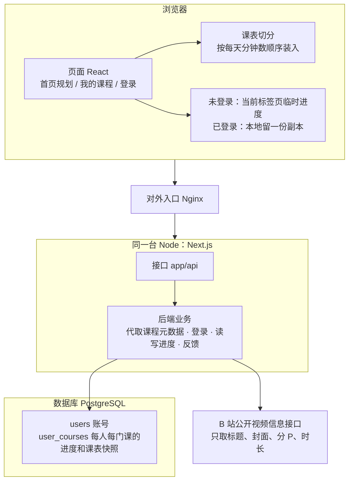

# 方案设计

状态：已确认，作为第一版方案基线。  
配对文档：《初始需求分析》。本文只覆盖第一版。广场、更新日志不在本文范围内。

## 1. 产品形态

网站，不是 App。电脑和手机用同一套页面。

第一屏只有三样东西：一句结果（把长课变成每天看得到的计划）、一个粘贴框、一个开始按钮。每天分钟数放在按钮旁边，默认 120。生成后才出现按天排列的课表，当天任务放在最显眼的位置。

界面要让人觉得值得付钱：用户 10 秒内知道自己会得到一张按天的课表。第一版不出现价格，也不做会员额度。

未登录可以生成课表。登录只为了把进度按账号存进数据库。

## 2. 界面

参考页是 [鱼皮 AI 导航 · 绘图提示词](https://ai.codefather.cn/painting)：白底、主色蓝 `#1777FF`、字色近 `#1F1F1F`。顶栏左侧是标志和名字，中间是少量文字导航，右侧是登录。标题是一句完整结果，下面一行补充说明，然后是一个主操作。按钮是胶囊形，主按钮蓝底白字。

课表站照这套骨架做：

1. 白底，只用这一种蓝做按钮、当前天和链接。
2. 标题写成结果，例如「长视频课，变成每天的学习课表」。
3. 粘贴框就是全页的主操作，对应参考站的搜索框。
4. 主按钮用胶囊形蓝按钮。
5. 顶栏保持短：规划、我的、登录。

参考站下方是图片卡片墙。课表站的结果是按天的清单，沿用顶栏、标题和按钮的样式，结果区用清单。

手机上顶栏收成标志和登录，标题和粘贴框仍然排在第一屏。粘贴、生成、看到当天任务，都不需要左右滑动找按钮。

## 3. 课程数据怎么拿

yt-dlp 是 youtube-dl 的 Python 分支，用命令行从包括 B 站在内的大量站点提取信息并下载视频。对单个多 P 视频，它可以列出每一 P 的标题和时长。`--dump-json` 可以不把视频存进磁盘，但进程仍会做格式探测，并依赖本机 Python。

规划器要的字段只有：BV 号、标题、封面、分 P 序号、分 P 标题、时长（秒）。

服务端请求 B 站公开的视频信息接口，读出分 P 列表里每一 P 的时长。选用哪些接口，参考 yt-dlp 的 B 站提取器已经走通过的公开接口。运行时不安装、不调用 yt-dlp，也不保存视频文件。浏览器不能直接请求 B 站，所以请求从自己的后端发出。

第一版只支持「一个视频下面的多 P」。合集是另一种链接结构，留到下一版：仍只取元数据，只改「分集列表从哪来」。

## 4. 课表怎么切

输入：按顺序的分集列表（每集有秒数），以及每天可用分钟数。  
输出：第 1 天到最后一天。每一天包含若干完整分集；最后一集如果放不下，就记录从这一集的第几秒看到第几秒。页面上写成「第几集的第几分钟」。

规则：

1. 按分集原顺序往当天的剩余秒数里装。
2. 剩余秒数够一整集，这一集算今天看完。
3. 不够，就把这一集拆开：今天看到能看完的那一秒，明天从下一秒继续。
4. 改每天分钟数后，整张课表重算。已勾过的「第几天」不自动套到新课表上，避免把旧进度安到错误的内容上。重算时用一句话告诉用户进度已重置。

计算放在前端，改分钟数可以立刻重算。后端只负责拿课程元数据和存进度。

生成结果要能代替原来发到微信的那条手工记录：今天看哪些集；若在一集中间停下，写到第几分钟。可用图片把当天计划导出。

## 5. 技术架构

一个 Next.js 应用。浏览器、接口、数据库分工如下。没有第二套后端服务。

线上由 Nginx 把访问转到 PM2 守护的 Next.js。

## 6. 技术栈

### 前端

| 项 | 选型 | 职责 |
|----|------|------|
| 框架 | Next.js 14（App Router）+ React 18 | 首页、我的课程、登录弹层 |
| 语言 | TypeScript 5 | 课程、课表、进度的数据结构 |
| 样式 | Tailwind CSS 3 | 白底、单一蓝色、胶囊主按钮；手机同一套页面往下排 |
| 运行位置 | 浏览器 | 识别链接、按分钟切课表、标出今天看到第几集第几分钟 |
| 本机存储 | sessionStorage / localStorage | 未登录只留本次访问；登录后作数据库的本地副本 |
| 分享当天计划 | html2canvas | 生成一张可发到微信的图，代替手打记录 |

切分不请求数据库。改每天分钟数后在浏览器里立即重算。

### 后端

| 项 | 选型 | 职责 |
|----|------|------|
| 运行时 | Node.js 18+ | 跑这一个 Next.js 应用 |
| 接口 | Next.js Route Handler | 课程元数据、登录注册、进度同步、反馈、健康检查 |
| 业务代码 | 服务端模块，接口文件只做转发 | 代取 B 站、校验密码、按用户读写进度 |
| 登录 | Node `crypto`：scrypt 存密码，HMAC-SHA256 签登录凭证 | 密码和签名密钥不进浏览器；凭证 7 天过期 |
| 数据库驱动 | postgres.js | 用连接串访问 PostgreSQL |
| 课程数据 | B 站公开信息接口 | 借鉴 yt-dlp 已用过的接口，只取元数据；运行时不调用 yt-dlp |
| 部署 | 云服务器 + Nginx + PM2 | 对外一个端口，进程异常退出后自动拉起 |

### 数据库

| 项 | 选型 | 职责 |
|----|------|------|
| 数据库 | PostgreSQL（Supabase 托管） | 配好连接串后启用 |
| 连接 | 连接串，非本机要求 SSL | 服务器通过环境变量读取，不写进代码仓库 |

| 表 | 一行是什么 | 关键内容 |
|----|------------|----------|
| `users` | 一个账号 | 用户名唯一；密码盐；密码哈希 |
| `user_courses` | 某个用户的一门课 | 用户 + BV 号唯一；每天分钟数；已完成的天；生成时的课表快照 |

课表快照和已完成天数用 JSONB 存。未登录用户在这两张表里没有行。密码只存哈希。

## 7. 页面

1. 首页：粘贴、设置每天分钟、生成、按天查看、标出今天已看完。
2. 我的：登录后列出自己导入过的课，点进去恢复上次的课表和进度。
3. 登录注册：一个弹层即可。
4. 反馈：一个入口，内容存下来供作者看。后面的功能从这里长出来。

## 8. 以后加功能时怎么接

1. 新功能先看是不是「少心算、少手记」。不是这件事的，单独开一版再做。
2. 删除部分分 P、支持合集：只改「分集列表从哪来」，不改切分规则。
3. 不把视频文件引入数据流。
4. 广场、更新日志不进 `users` 和 `user_courses`。若以后要做，另加存储，不改本文这两张表的职责。
